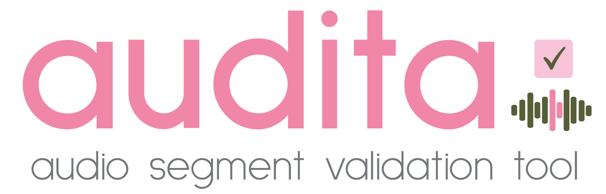

<p align="center">
  
</p>

<h3 align="center">
  Audio segment validation tool
</h3>

---

audita es una aplicación de escritorio para **escuchar, revisar y clasificar segmentos de audio** (WAV, WAVE, FLAC y OGG). Permite consultar el espectrograma, guardar validaciones y continuar un trabajo anterior.

La interfaz de la aplicación está en inglés.

## Instalación y apertura

Necesitas **Python 3.10 o posterior**.

1. Descomprime el paquete de audita en una carpeta.
2. Mantén juntos los archivos de la aplicación, incluido `audita.py` y `requirements.txt`.
3. Abre PowerShell en esa carpeta y ejecuta:

   ```powershell
   python -m pip install -r requirements.txt
   python audita.py
   ```

La primera orden instala las bibliotecas necesarias; para volver a abrir audita, basta con ejecutar `python audita.py`.

## Cómo validar segmentos

1. **Validator:** introduce tu nombre para habilitar los controles.
2. **Open folder:** selecciona la carpeta de audios. audita también busca en sus subcarpetas.
3. **Proposed species:** selecciona una especie para filtrar los segmentos o deja **All species** para revisarlos todos.
4. **Segment:** elige un archivo. Los segmentos aparecen ordenados por la confianza numérica indicada al principio de su nombre, de mayor a menor.
5. **Play:** escucha el segmento mientras observas el espectrograma. Puedes marcarlo como favorito pulsando la estrella.
6. **Classification:** asigna una de estas categorías:
   - **Positive:** identificación correcta.
   - **Negative:** identificación incorrecta.
   - **Uncertain:** no es posible decidir con seguridad.
   - **Reassigned:** corresponde a otra especie; escribe su nombre científico en **Validated scientific name** y pulsa **Enter**.
   - **Multitaxa:** aparecen varios taxones; escribe los nombres separados por `;` y pulsa **Enter**.
7. **Validation comment:** escribe una observación si la necesitas.

Al clasificar, audita **guarda automáticamente** y avanza al siguiente segmento pendiente del filtro seleccionado.

## Seguir el progreso

Debajo del espectrograma, **Status** indica si el segmento actual está pendiente o ya tiene una categoría asignada. La información se mantiene cuando vuelves a un segmento revisado.

- **Pending →:** busca el siguiente segmento sin clasificar.
- **Undo:** deshace la última clasificación.
- **Skip:** pasa al siguiente pendiente sin clasificar el actual.
- **SUMMARY:** muestra el total, los segmentos completados, los pendientes y el porcentaje de avance.

Cuando todos los segmentos de la carpeta están clasificados, aparece el aviso **Validation completed**.

## Guardado y exportación

audita guarda el trabajo automáticamente en **`validaciones.csv`**, dentro de la carpeta de audios seleccionada. Si abres nuevamente esa carpeta, recupera las validaciones anteriores.

El botón **Save CSV** sirve para exportar una copia a otra ubicación. No es necesario pulsarlo después de cada clasificación.

El CSV incluye las siguientes columnas:

```csv
observationID,mediaID,scientificNameProposed,validationCategory,scientificNameValidated,classifiedBy,favorite,fileName,validationComment
```

Los favoritos pueden guardarse aunque todavía no tengan categoría. **Los archivos de audio originales no se modifican.**

## Atajos de teclado

| Tecla | Acción |
| --- | --- |
| **P** | Positive |
| **N** | Negative |
| **U** | Uncertain |
| **R** | Reassigned |
| **M** | Multitaxa |
| **Espacio** | Reproducir / detener |
| **← / →** | Segmento anterior / siguiente |
| **Ctrl + Z** | Deshacer |
| **Ctrl + S** | Guardar |
| **Ctrl + O** | Abrir carpeta |
| **Ctrl + Shift + S** | Exportar CSV |
| **Enter** | Confirmar el nombre científico |
| **F1** | Mostrar los atajos |

Los atajos de clasificación se desactivan mientras escribes en los campos de texto.

## Si algo no funciona

- **Los botones están desactivados:** completa primero el campo **Validator**.
- **No aparecen segmentos:** comprueba que la carpeta contiene archivos WAV, WAVE, FLAC u OGG, o que están en alguna subcarpeta.
- **No se reproduce el audio:** comprueba que tienes un dispositivo de sonido conectado y que instalaste las dependencias con el comando de instalación.
- **Quieres continuar otro día:** vuelve a abrir la misma carpeta de segmentos; audita leerá el archivo `validaciones.csv` existente.
